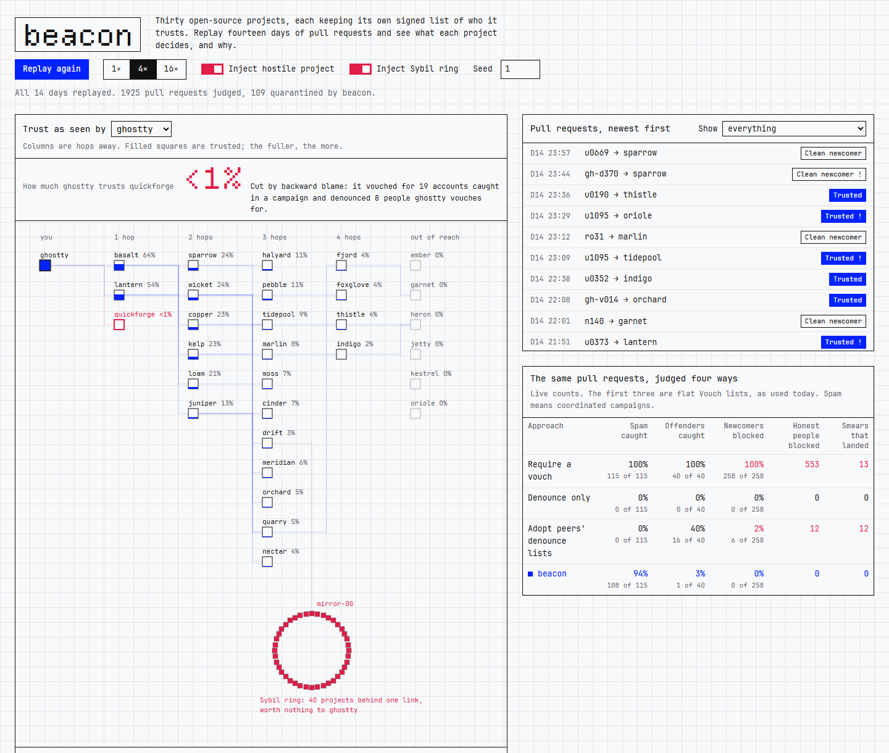

# beacon

A trust network for open-source projects that keeps coordinated pull-request
spam out without locking newcomers out.



Each project keeps its own signed list of who it vouches for and who it has
denounced, in its own Git repo. Projects choose which other projects they trust
and how much. When a pull request comes in, beacon gives one of three answers:

- **Trusted:** projects you trust, directly or through projects they trust,
  vouch for this person.
- **Clean newcomer:** nobody knows them yet, and nothing looks wrong. Never
  blocked for being new.
- **Quarantined:** independent projects you trust denounce them, or their PR is
  part of a coordinated wave across many repos.

Every answer explains itself in plain English: who said what, through which
projects, how long ago, and whether the verdict hangs on a single source.

beacon builds on Mitchell Hashimoto's [Vouch](https://github.com/mitchellh/vouch)
and reads its `VOUCHED.td` files directly. It started from a close look at
Ghostty's real list: [docs/RESEARCH.md](docs/RESEARCH.md).

## See it

```sh
cargo run --release -- serve
```

Open <http://127.0.0.1:8080> (or pass `--addr` to pick another port), turn on **Inject hostile project** and **Inject
Sybil ring**, and press **Replay 14 days**. Things to watch:

- **Ghostty's trust in the hostile project** drops in the readout as the
  accounts it vouched for are caught in campaigns.
- **The Sybil ring**, 40 fake projects behind one careless link, ends up worth
  nothing.
- **The scoreboard** shows the same pull requests judged by flat Vouch lists
  and by beacon.
- **Any PR** opens its evidence card. The trust paths behind it light up on the
  graph.

You can link straight to a run: `/?hostile=1&sybil=1&play=320`.

## Results

Fourteen simulated days, 30 projects (Ghostty's real list included, with
pseudonymized handles), about 1,900 PRs. Seed 1, both attacks on:

| | Spam caught | Newcomer PRs blocked | Honest people blocked | Smears that landed |
|---|---:|---:|---:|---:|
| Flat Vouch, require a vouch | 100% | **100%** | 553 | 13 of 17 |
| Flat Vouch, denounce only | 0% | 0% | 0 | 0 of 17 |
| Flat Vouch, adopt peers' lists | 0% | 2.3% | 12 | 12 of 17 |
| **beacon** | **94%** | **0%** | **0** | **0 of 17** |

Over five seeds beacon catches 94–95% of coordinated campaign spam and blocks no
honest PRs. Where it's weaker is written up honestly too:
- Repeat offenders denounced by only one project get a warning, not a block.
- Spam that varies its structure as well as its words drops recall to 63–82%.
- These results come from a simulation.

[docs/BENCHMARKS.md](docs/BENCHMARKS.md) has the details, plus statistics from
about 2,600 real spam-labelled PRs.

## How it works

- **Signed, Git-native ledgers.** `.trust/ledger.jsonl` entries are ed25519
  signed and hash-chained. Peers are fetched read-only with `git`.
- **Subjective trust.** There's no global score. Trust flows from *your*
  project, fading with each hop.
- **Max-flow, not counting.** No project can contribute more evidence than you
  trust it with, so forty fakes behind one link count as one.
- **Backward blame.** Vouching for someone later caught, or denouncing someone
  you vouch for, costs a project your trust automatically.
- **Campaign detection without contents.** Fingerprints keep a salted author
  hash, a SimHash of the words and a SimHash of the *layout*, which survives
  rewording, plus coarse diff shape. No PR text is stored.
- **Single-source check.** Every verdict is re-run with each contributing
  project removed (100–350 µs) and says so if one of them decides it.
- **Optional LLM summaries.** Groq, with any model set in `.env`. The LLM only
  rewords a correct draft, and its note is thrown out if it doesn't match the
  evidence.

Design and trade-offs: [docs/ARCHITECTURE.md](docs/ARCHITECTURE.md). What it
does and doesn't defend against: [docs/THREAT_MODEL.md](docs/THREAT_MODEL.md).

## Use it on a project

```sh
beacon init myproject --maintainer alice        # writes .trust/ and a signing key
beacon import .github/VOUCHED.td                # bring over an existing Vouch list
beacon vouch github:newcomer --reason "solid first PR"
beacon vouch github:student --provisional 30 --scope docs
beacon denounce github:spammer --reason "same PR opened in 30 repos"
beacon trust zig 0.8 --url https://github.com/ziglang/zig
beacon sync                                     # fetch peers' signed ledgers
beacon peers                                    # how much you trust each project, and why
beacon verdict github:newcomer                  # decision, evidence card and summary
beacon verify                                   # check every signature and the chain
```

Existing Vouch files work too:

```sh
beacon inspect data/ghostty/VOUCHED.td
beacon check data/ghostty/VOUCHED.td mitchellh  # same exit codes as `vouch check`
```

Other commands: `beacon sample` prints evidence cards for six interesting cases,
and `beacon bench --seeds 5` reruns the benchmark.

### LLM summaries (optional)

Copy `.env.example` to `.env` and set `GROQ_API_KEY` and `GROQ_MODEL`. Without
them, or whenever the LLM is unavailable or off-target, beacon uses its built-in
summary. Nothing leaves your machine unless a key is set.

## Development

```sh
cargo fmt --all --check
cargo clippy --all-targets -- -D warnings
cargo test
```

When working on the UI, `BEACON_UI_DIR=ui cargo run -- serve` serves files from
disk so edits show up on reload.

Everything lands through pull requests; `main` is never pushed to directly.

## License

MIT. Fonts in `ui/fonts` are under the SIL Open Font License: JetBrains Mono
and Departure Mono.
